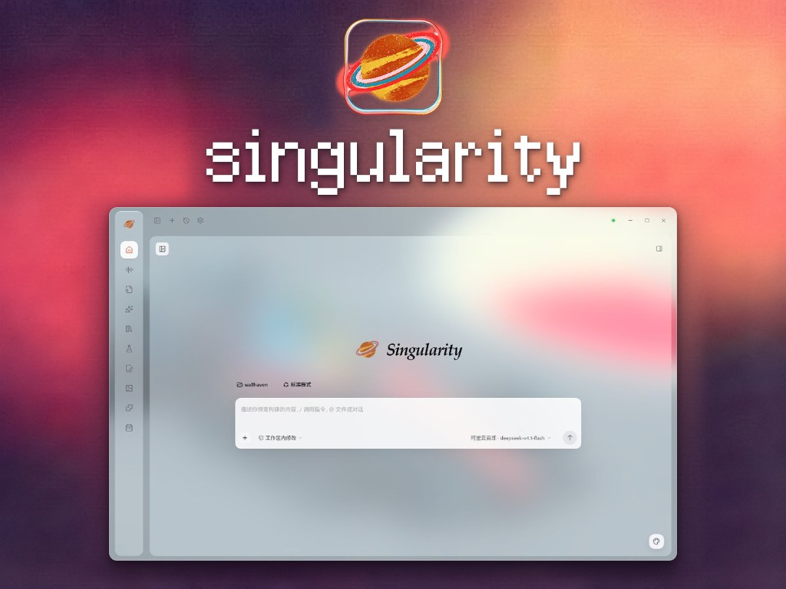
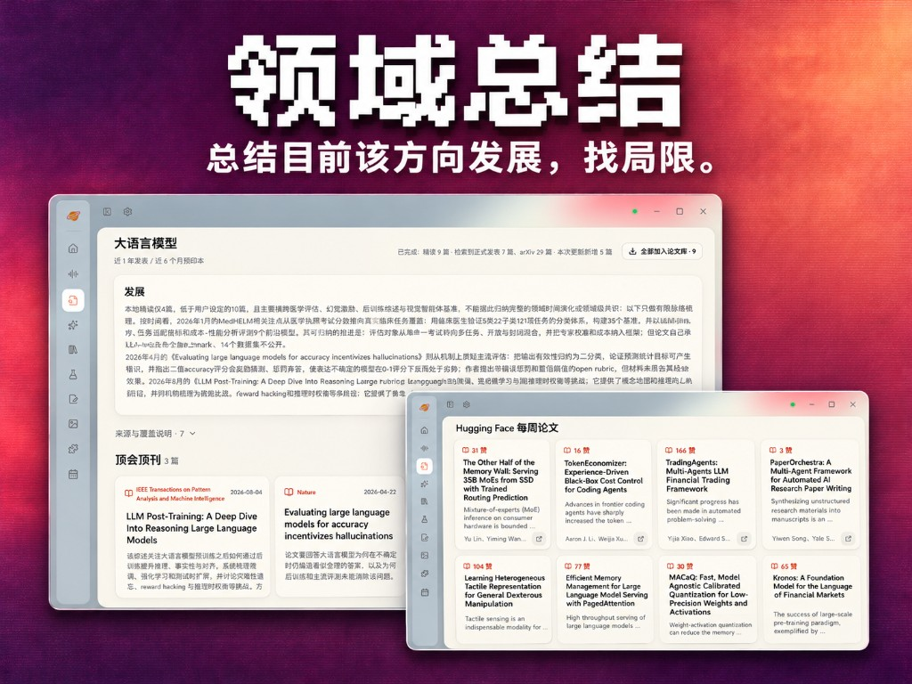
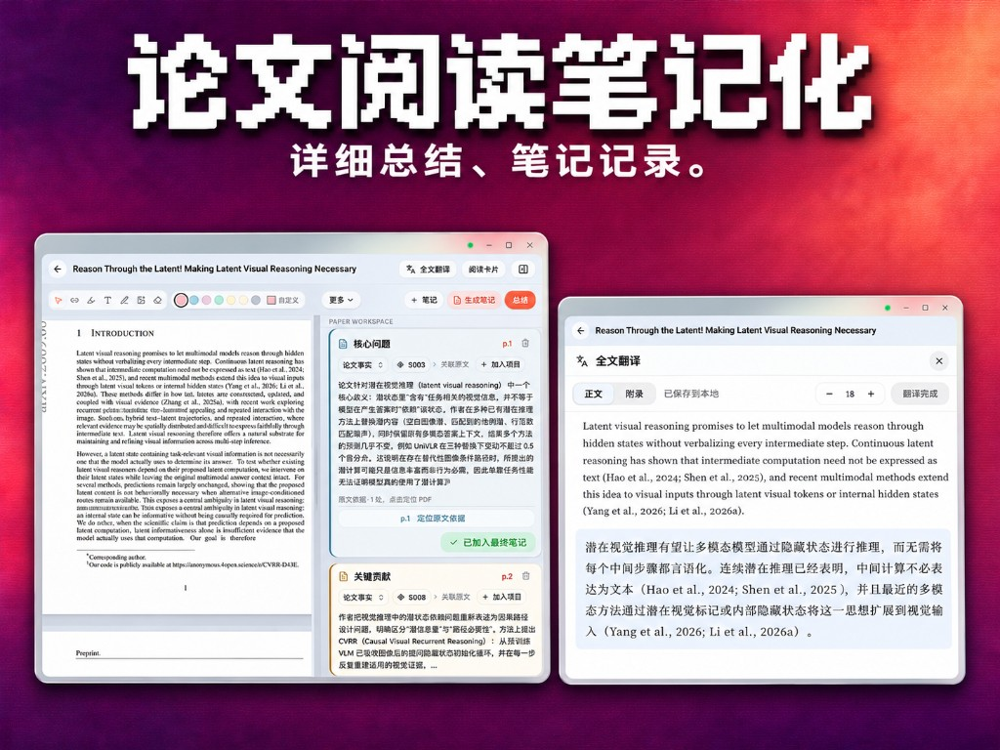
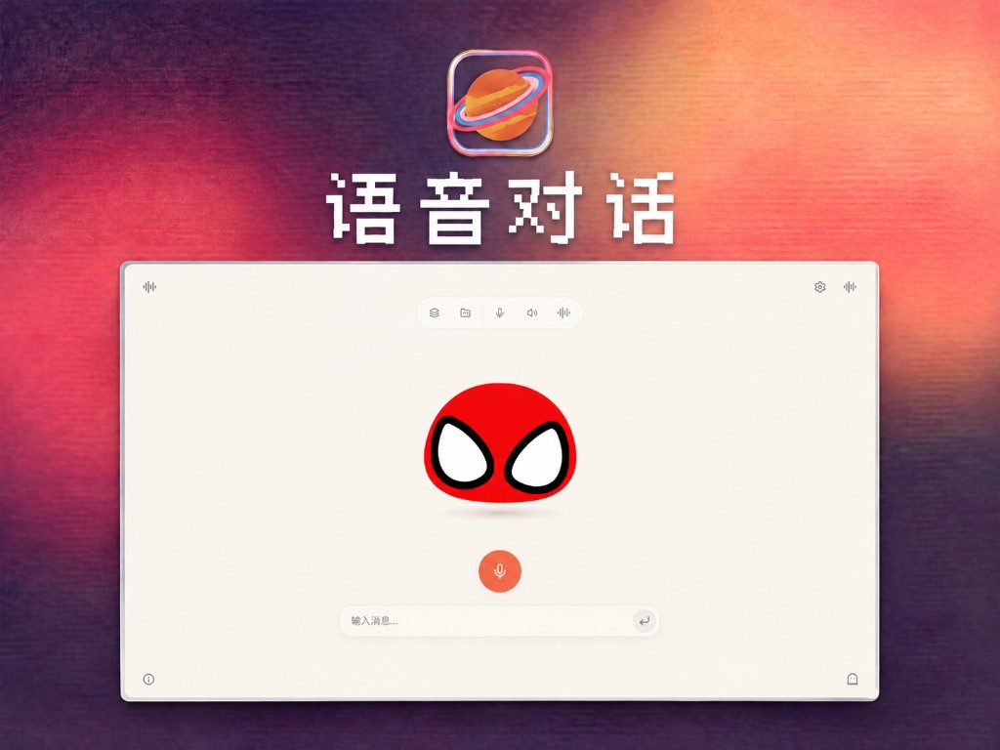

# Singularity

Singularity，科研 agent 助手，基于 DeepSeek Harness，人与 AI 的深度协作，把科研这件事做得更具体、更完整：

内置真正的论文阅读器，划重点、查脉络、记笔记、溯源原文，把文献真正内化成自己的思考。把全流程串联在一个工作台里，从领域追踪与找论文 → 深度精读笔记 → 研究项目与 idea 迭代 → 计划管理 → 深度 LaTeX 论文写作，集成优秀 Skill。



## 功能概览

- **首页对话**：基于 DeepSeek Harness。输入 `@` 可以引用你建好的领域，或论文库里的一篇、多篇论文。
- **论文库**：导入 PDF，阅读、检索、翻译和做笔记。原文件不会被删掉。
- **科研发现**：按领域积累论文，生成可追溯的综述，并记下你自己的研究笔记。
- **研究项目与 LaTeX 写作**：使用 LaTeX 进行写作。
- **语音对话**：接入 Breeze TTS 2 模型、MiniMax 模型或其他语音模型。
- **计划**：月历、任务和待办。
- **图片生成**：可选的 MiniMax 图片接口。








## 不会装？把这段话交给助手

把下面整段复制给任意编程助手。它会在你的 Windows 电脑上克隆仓库并启动应用。密钥不要写进这段话，也不要让助手代填。

```text
请在这台 Windows x64 电脑上安装并启动 Singularity，不要改系统 git 配置，不要创建或提交任何 API Key。

仓库：https://github.com/TytopiaAI/singularity-research-agent

步骤：
1. 检查 Node.js 是否为 24 或更高版本。如果没有，告诉我去 https://nodejs.org/ 安装 Node.js 24，装好后再继续。
2. 在终端执行 corepack enable，以启用仓库要求的 pnpm 11。
3. 把仓库克隆到我指定的空目录（如果我没指定，就克隆到当前用户目录下的 singularity-research-agent）。命令：
   git clone https://github.com/TytopiaAI/singularity-research-agent.git
4. 进入仓库根目录，执行 pnpm install，然后执行 pnpm dev。
5. 不要读取、复制或提交 .local-data、.env、数据库、日志。这些目录要么不存在，要么已被 Git 忽略。
6. 启动后告诉我：第一次打开会先看到欢迎页。点「下一步」进入「配置对话模型」，API Key 由我自己粘贴；语音可以继续用 Windows 本地识别和朗读，不需要 Key。
```

## 安装并运行

需要 **Windows x64**、[Node.js 24](https://nodejs.org/) 或更高版本。pnpm 11 已经写在仓库里，用 Corepack 启用即可。

```powershell
corepack enable
git clone https://github.com/TytopiaAI/singularity-research-agent.git
cd singularity-research-agent
pnpm install
pnpm dev
```

第一次打开会先看到启动画面，然后是欢迎向导：

1. **欢迎来到 Singularity**
2. **配置对话模型**（填入 API Key 后才能对话、综述和写作）
3. **配置语音**（可继续用 Windows 本地语音，不需要 Key）
4. **进入应用**

数据写在项目下的 `.local-data`。这个目录已经被 Git 忽略，克隆下来是空的。

常用检查：

```powershell
pnpm test
pnpm typecheck
pnpm build
```

`pnpm build` 只构建本机运行所需的文件，不会生成安装包。

## 配置 API Key

密钥不要写进仓库，也不要提交 `.env`。欢迎向导和「设置」页接收密钥，并用 Windows DPAPI 加密后保存在数据目录。界面读不回明文。

`.env.example` 只列出可选的本机路径和开发地址。复制成 `.env` 也不会被当成密钥文件读取：

```powershell
copy .env.example .env
```

### 对话（LLM）

在欢迎向导的「配置对话模型」，或之后的设置页填写：

| 服务商 | 接口 | 模型示例 | 需要的密钥 |
| --- | --- | --- | --- |
| DeepSeek 官方 | `https://api.deepseek.com` | `deepseek-chat` | DeepSeek API Key |
| OpenAI 兼容接口 | 服务商给的 Chat Completions 地址 | 服务商的模型名 | 该服务商的 API Key |

有了这项密钥，首页对话、科研发现、论文阅读和写作里的模型功能才能使用。不填也可以先浏览界面，之后在设置里补上。

### 语音（识别 / 朗读）

| 方式 | 识别 | 朗读 | 需要的密钥 |
| --- | --- | --- | --- |
| Windows 本地 | Windows 语音识别 | Windows 语音合成 | 不需要 |
| DeepSeek | DeepSeek ASR | DeepSeek TTS（Stella / Tide） | DeepSeek API Key |
| MiniMax | MiniMax | MiniMax | MiniMax API Key |

Windows 方式在欢迎向导里直接选即可。云端语音只在你开启语音对话时调用，费用按各家官网计算。

图片生成如果要使用，在图片页单独填写 MiniMax API Key。

## 使用示例

**读一篇论文再问它**

1. 打开「论文库」，导入一篇 PDF。
2. 回到首页，输入 `@`，在「论文」里点选这篇。要引用多篇，就再输入一次 `@`。
3. 问一个具体问题。助手会先读取论文开头，并按页码引用。

**围绕一个领域往下做**

1. 在「科研发现」里建立领域，例如「强化学习」。
2. 回到首页，输入 `@`，点选这个领域。
3. 让助手根据已有综述找出还没做完的问题。没有综述时，它只会依据领域里已经收录的内容，不会编造论文。

## 数据放在哪里

开发时默认数据目录是项目下的 `.local-data`（数据库、缓存、日志、加密后的密钥）。可以用环境变量 `SINGULARITY_DATA_ROOT` 指到别的空目录。安装版会把数据放在安装目录上一级的 `SingularityData` 文件夹。

## 许可证与致谢

你可以把这个仓库克隆到自己的电脑上安装和运行，界面运行在 Electron 上，研究对话使用 [DeepSeek Harness](https://github.com/TytopiaAI/singularity-research-agent/blob/main/third-party/harness/README.md)，PDF 阅读使用 PDF.js。这些组件适用它们各自的许可证。
